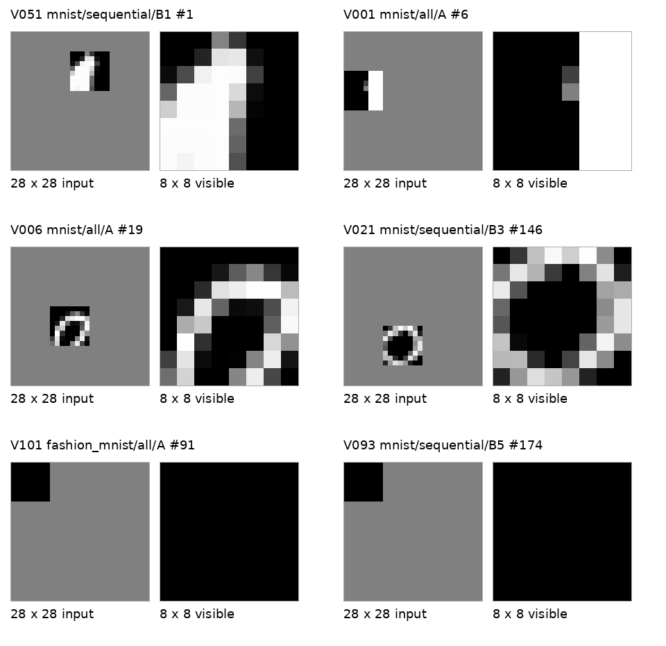

# V4 Luna: mask 설명 수정과 V3 비교

2026-10-26 KST. 프로젝트에서 다시 볼 실험·분석 기록이므로 `report/2026-10-26/`에 저장한다.

입력 설명만 바꾼 V4 Luna 12회를 모두 완료했다. **mask의 의미를 더 명확히 설명해도 perception 오류는 남았다.** MNIST 순차에는 획과 방향을 분리해 조합한 예가 생겼지만, Fashion 순차의 표현 증가는 대부분 단일 concept의 반복 적용이었다.

- 정의는 V3 53개에서 V4 40개, 표현은 96개에서 152개로 바뀌었다. 이 수치는 품질 점수가 아니다.
- 선택된 설명에서 명확한 불일치는 V3 20.8%, V4 22.4%였다. 표본이 달라 정확도 개선량으로 해석할 수 없다.
- 좌우·방향·명암·고리의 닫힘을 틀린 사례가 남았다. 전부 검정인 창에 가로 선 세 개를 만들어 설명한 경우도 있었다.
- MNIST 순차에는 실제 밝은 획에 별도 세로 방향 concept을 적용한 올바른 예가 생겼다.
- 한 번 입력 조건에서 인용 근거가 앞쪽에 더 몰렸다. 내부 attention이나 뒤쪽을 실제로 읽었는지는 측정하지 않았다.

웹 보고서: [V4 자체 분석·V3 비교](https://hyeonscho.github.io/pap-viewer/concept-v4/analysis.html). Concept 전체: [V4 viewer](https://hyeonscho.github.io/pap-viewer/concept-v4/).

## 바꾸는 문구

각 이미지는 28×28 grayscale 원본에서 **8×8 영역만 보이게 하고 나머지를 가린 이미지**다. 창 안의 픽셀은 원본 값을 그대로 유지하며, 창 밖은 원본 내용과 관계없이 모두 회색(픽셀 값 128)으로 덮었다. **창 밖의 회색과 관찰창의 사각형 경계는 가림 처리로 생긴 것이므로, 원본의 배경이나 물체 모양으로 해석하지 마라.** 창 안에도 실제 값이 128인 픽셀이 있을 수 있으므로, 회색이라는 이유만으로 가려진 영역이라고 판단하지 마라.

모델에 전달하는 영문은 다음과 같다.

```text
Each image is a 28x28 grayscale original with only an 8x8 region left visible and the rest masked out. Pixels inside the window retain their original values; outside the window, all pixels are replaced with gray (pixel value 128), regardless of the original content. The gray exterior and the rectangular window boundary are artifacts of masking, so do not interpret them as the original image background or object shape. Pixels inside the window may genuinely have value 128, so do not identify a region as masked merely because it is gray.
```

V3 입력 설명의 첫 두 문장만 교체했다. CORE, 나머지 COMMON, schema, 이전 catalog 전달 규칙, 원본 metadata 비공개 및 숨겨진 연결을 추측하지 말라는 지시는 유지한다. 별도 concept 금지 목록이나 끝점 규칙은 추가하지 않았다.

## 고정 조건

- Baseline: V3 Luna `concept_v3_luna56_high_20261025`.
- V4: `concept_v4_luna56_high_20261026`, 전용 branch `task/concept-v4-luna-20261026`.
- 기존 ChatGPT 구독 backend, `gpt-5.6-luna/high`. GPU·wandb·별도 API key 호출 없음.
- MNIST·Fashion-MNIST 각각 원본 210장과 8×8 관찰 1,050개. 각 dataset에서 1,050개 한 번, 210개씩 5회. 총 12회.
- V3 입력 PNG bytes, 순서, raw grayscale, mask, shuffle seed, timeout 1,800초, response 제한 2 MiB 유지.
- 네 조건은 빈 catalog로 시작한다. 순차 조건은 V4 자신의 이전 정의·review notes만 누적하며 이전 expression은 넘기지 않는다.
- V3와 V4의 선택한 근거는 달라질 수 있다. 인용 없음은 detection failure가 아니며 한 번의 비교를 prompt의 인과적 효과나 모델 정확도로 해석하지 않는다.

## 분석 기준

V3 감사와 같은 선택 규칙으로 V4의 각 definition 첫 근거와 모든 expression을 직접 검토한다. 보이는 픽셀과 설명의 일치는 supported·contradicted·indeterminate로 기록하고, mask/관찰창을 원본 구조로 해석했는지는 별도 flag로 남긴다. Definition과 expression을 구분해 분모와 중복 관찰 수를 함께 기록한다.

V4 자체의 concept 내용·factor 분리·재사용·실제 근거·불일치와 불확실성을 분석한다. V3와는 정의·표현 수, mask 의존, 실제 내용 concept의 조합, 같은 관찰의 설명, 근거 선택 위치와 인용 집합을 비교한다. 전체 labeling이나 human GT 평가는 하지 않는다.

## 출력과 composition

| 조건 | 정의 V3 → V4 | 표현 V3 → V4 | part ≥ 2인 표현 V3 → V4 | 인용한 관찰 V3 → V4 |
|---|---:|---:|---:|---:|
| MNIST 한 번 | 10 → 8 | 10 → 10 | 9 → 1 | 31 → 30 |
| MNIST 순차 | 12 → 14 | 32 → 44 | 20 → 34 | 82 → 76 |
| Fashion 한 번 | 12 → 10 | 14 → 7 | 11 → 7 | 73 → 55 |
| Fashion 순차 | 19 → 8 | 40 → 91 | 34 → 9 | 112 → 139 |

**MNIST 순차:** V3의 multi-part 표현 20개는 모두 검정 관찰창 carrier를 포함했고 이를 빼면 part가 하나씩 남았다. V4는 창 접촉 concept을 빼도 multi-part 표현 30개가 남는다. 거의 어두운 창이라는 concept까지 빼면 29개다. 이는 참조 구조의 차이이며 모든 조합의 의미 독립성이나 정확성을 검증한 수치는 아니다.

V4 B1 #1은 `Light stroke fragment + Vertical stroke orientation`으로 나누었다. 영어 조합 설명도 방향 속성이 획 instance를 설명한다고 명시했다. 실제 픽셀에 밝은 세로 조각이 있어 이 예는 일치한다. 그러나 밝은/어두운 획·넓은 영역·고리를 별도 concept으로 만드는 중복이 남았고, 방향 concept의 정의는 밝은 mark에 한정돼 있다. B4의 `/expressions/0`, `/expressions/5`에서 그 방향을 어두운 획에 적용한 것은 정의와 사용 범위가 맞지 않는다. B3 `/expressions/3`은 밝은 내부를 설명하면서 거의 어두운 창 concept을 interior로 쓴 문제도 있다.

**Fashion 한 번:** 선·명암·방향·나란함을 비교적 명확히 나누었다. 그러나 구조가 잘 분리된 조합도 없는 선을 만들어 낼 수 있다. A #91의 여섯 part 조합이 그 예다.

**Fashion 순차:** B1에서 만든 정의 8개를 B5까지 유지했다. V3의 19개보다 작지만, V4 표현 91개 중 multi-part는 9개다. 특히 B5의 표현 53개는 모두 단일 part다. 전체 표현 증가분 56개 중 35개는 이 B5 증가에서 왔다. 작은 catalog를 재사용한 사실과, 적은 factor를 조합해 다양한 모양을 표현한 성과를 구분해야 한다.

## V4 자체의 perception 감사

V3와 같은 선택 규칙으로 각 definition의 첫 근거와 모든 expression을 직접 보았다. V4는 설명 192개, 서로 다른 관찰 155개·원본 129장이다. V3는 설명 149개, 관찰 106개·원본 95장이었다. 같은 이미지에서 나온 설명이 중복되며 독립적인 human GT는 아니다.

| 버전 | 검토한 설명 | 픽셀과 일치 | 명확한 불일치 | 판단 보류 |
|---|---:|---:|---:|---:|
| V3 | 149 | 82 (55.0%) | 31 (20.8%) | 36 (24.2%) |
| V4 | 192 | 104 (54.2%) | 43 (22.4%) | 45 (23.4%) |

V4 definition 첫 근거는 일치 17·불일치 16·보류 7, expression은 일치 87·불일치 27·보류 38이다. 선택된 표본이 다르므로 20.8% → 22.4%를 성능 하락이나 prompt 효과로 해석하지 않는다. 다만 기존 오류가 전반적으로 해결됐다는 증거는 없다.

대표 사례의 이미지는 왼쪽이 실제 28×28 입력, 오른쪽이 보이는 8×8을 확대한 것이다. 크기만 확대했으며 픽셀 값은 그대로다.



| 감사 ID · 입력 | Luna의 핵심 주장 | 픽셀에서 확인한 내용 |
|---|---|---|
| V051 · MNIST B1 #1 | 밝은 획 + 세로 방향 | 실제 밝은 세로 조각과 일치한다. |
| V001 · MNIST A #6 | 밝은 세로 막대가 왼쪽 | 실제로는 보이는 창의 오른쪽이다. |
| V006 · MNIST A #19 | 밝은 ring이 어두운 중심을 둘러쌈 | 아래가 열려 있어 enclosure 주장은 맞지 않는다. |
| V021 · MNIST B3 #146 | 어두운 contour가 밝은 내부를 감쌈 | 실제로는 밝은 테두리와 어두운 중심이다. |
| V101 · Fashion A #91 | 어두운 가로 선 세 개가 나란함 | 보이는 64개 픽셀이 모두 0이다. 선이 없다. |
| V093 · MNIST B5 #174 | 채워진 어두운 사각형 | 검정 픽셀 자체는 맞지만 사각 외곽은 관찰창이 만든 경계다. |

일치한 예는 단순한 방향·명암 덩어리와 일부 뚜렷한 junction이다. 낮은 해상도에서 여러 획의 교차, 작은 loop, texture를 구분하기 어려운 사례는 보류했다. 곡선·고리 같은 이름을 제안했다는 사실과 그 이름을 올바른 픽셀에 적용했는지는 별개의 문제다.

감사 원문·이유·flag 전체: [audited_claims.json](audit.json), [judgments.tsv](audit.json). 각 기록에는 call·patch 번호, 원문 위치, 실제 입력 SHA-256이 있다.

## mask와 창 관계를 구분한 이유

`mask_artifact`는 설명한 사각형·덩어리의 외곽이 관찰창 경계에 의존하는 경우다. V3 36/149, V4 29/192 기록에 표시했다. 픽셀이 검정이라는 설명은 맞을 수 있으므로 불일치 판단과 별도다. 버전 간 선택 표본과 개념이 달라 이 비율 감소만으로 교정 효과를 주장하지 않는다.

`window_relation`은 mark가 관찰창 가장자리에 닿는다는 명시적 관계다. V4 `Visible-window edge contact` 정의 하나와 표현 일곱 개에 해당한다. 이것은 원본 도형의 intrinsic 속성과 다르다. 그러나 수정한 prompt는 창 경계를 원본 물체 모양으로 해석하지 말라는 지시이며, 관찰창과의 접촉 관계 자체를 금지한 것은 아니다. 따라서 관계를 제안했다는 이유만으로 오류나 지시 위반으로 세지 않았다. 두 flag는 겹칠 수 있다.

`Predominantly dark field`는 보이는 픽셀만 설명하고 배경이나 물체인지 추론하지 않는다고 명시했다. 그 정의 자체는 mask 오해로 분류하지 않았다.

## 같은 입력의 V3 오류 추적

| 동일 조건·동일 입력 | V3 | V4 | 판단 |
|---|---|---|---|
| MNIST A #9 | 입력 안에서 끝나는 endpoint | 보이는 대각선 | V4 설명은 픽셀과 일치. |
| MNIST B1 #6 | 밝은 부분이 왼쪽 | 작은 arc | V4에서도 곧은 세로 부분을 곡선으로 잘못 설명. |
| Fashion A #3 | 대각선으로 읽은 설명 | 대각선 획 | 실제 주된 대비 경계는 세로. 오류가 남음. |
| MNIST B2 #47 | 가는 세로 획 | 여러 arm이 만나는 junction | V4 설명은 픽셀과 일치. |

위 쌍은 PNG SHA-256이 같다. V3에서 불일치였던 31개 기록 중 9개 기록에 해당하는 입력이 V4에서도 인용됐다. 나머지 22개는 같은 조건에서 재인용되지 않았다. **인용 없음은 교정됐다는 뜻이 아니다.** 재인용된 기록에는 일치·불일치·보류가 섞여 있으며, 첫 근거 밖의 재인용 하나는 이번 감사 대상에 포함되지 않았다. 전체 추적은 [analysis.json](audit.json)의 `prior_error_followup`에 있다.

## 근거 선택 위치

아래 비율의 분모는 각 조건에서 실제로 인용한 서로 다른 관찰이다. 앞 10%는 한 번 조건의 #1–105, 순차 조건의 각 batch #1–21이다.

| 조건 | 앞 10%에서 고른 근거 V3 → V4 |
|---|---:|
| MNIST 한 번 | 71.0% → 83.3% |
| MNIST 순차 | 9.8% → 17.1% |
| Fashion 한 번 | 46.6% → 96.4% |
| Fashion 순차 | 20.5% → 21.6% |

한 번에 넣는 조건에서는 앞쪽 편중이 더 커졌다. 그러나 이는 출력에 인용한 위치의 분포다. 모델이 뒤쪽 입력을 안 봤다는 결론이나 내부 attention에 대한 측정은 아니다. 입력 순서를 바꾸는 비교는 이번 승인 범위에 없어 실행하지 않았다.

## 인용되지 않은 입력은 무엇인가

| 조건 | 인용 없는 관찰 | 그중 모두 검정 | 명암 차이가 있는 미인용 관찰 | 관찰 5개가 모두 미인용인 원본 |
|---|---:|---:|---:|---:|
| MNIST 한 번 | 1,020 | 5 | 1,015 | 181 |
| MNIST 순차 | 974 | 3 | 971 | 141 |
| Fashion 한 번 | 995 | 12 | 983 | 158 |
| Fashion 순차 | 911 | 11 | 900 | 109 |

각 조건의 전체는 관찰 1,050개·원본 210장이다. 미인용 대부분은 모두 같은 픽셀 값인 빈 창이 아니다. 호출별 미인용 입력에서 최소 명암 범위와 최대 표준편차를 고른 24개를 보니, 균일한 검정뿐 아니라 뚜렷한 가로·세로 경계와 밝은 대각선도 있었다. 예를 들어 MNIST B2 #184에는 밝은 대각선이 있고 Fashion B2 #77에는 세로 띠들이 있지만 인용되지 않았다.

이 discovery는 전체 입력을 빠짐없이 label하도록 요구하지 않는다. 따라서 미인용 이유가 중복·대표 근거 선택·앞쪽 편향·응답 길이·perception 실패 중 무엇인지 출력만으로 분리할 수 없다. 이를 “아무 concept도 발견하지 못한 이미지”나 recall로 부르면 안 된다.

미인용 실제 입력: [예시 1](report-assets/uncited_01.png), [예시 2](report-assets/uncited_02.png), [예시 3](report-assets/uncited_03.png). 픽셀 통계와 선택 규칙은 [uncited_sample.json](audit.json)에 있다.

## 검증과 한계

- 12회 실제 model 응답을 모두 받았고 실패·재시도 없이 완료했다.
- 원본 420장·관찰 2,100개의 PNG bytes와 입력 순서를 V3와 대조했다.
- 실제 prompt·schema·누적 catalog·account/model/effort·normalized command·실행 파일 digest를 검증했다.
- 근거 번호와 이미지 매핑, expression의 concept 참조를 검증했다.
- 전체 local CPU tests는 210개 통과했다. 분석·감사에는 추가 model 호출을 하지 않았다.
- 두 버전 각각 한 번의 실행이다. 반복 실행·순서 counterbalancing·human GT·전체 labeling·detector 전이·held-out 평가는 없다.

입력 설명을 명확히 한 뒤에도 픽셀을 잘못 읽는 사례가 남았다. 따라서 **concept의 분리·조합 구조와 실제 픽셀에 올바르게 적용하는 능력은 따로 평가해야 한다.**
